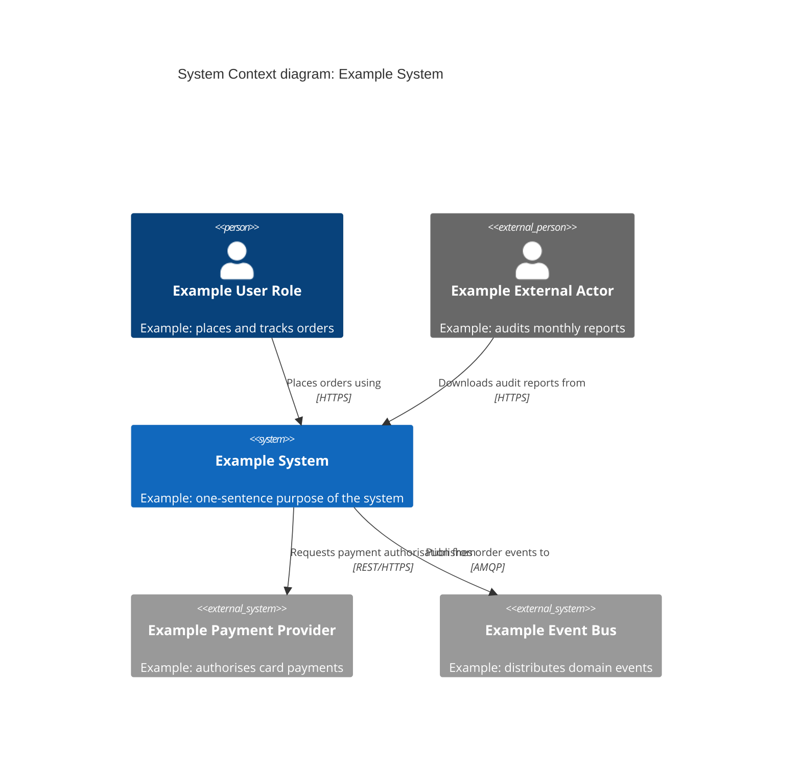
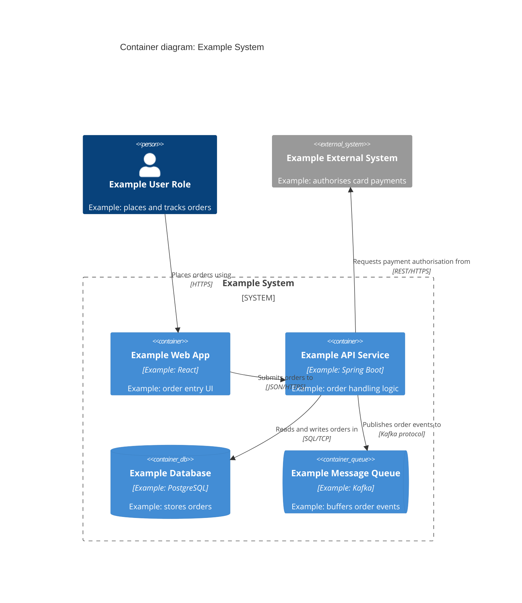
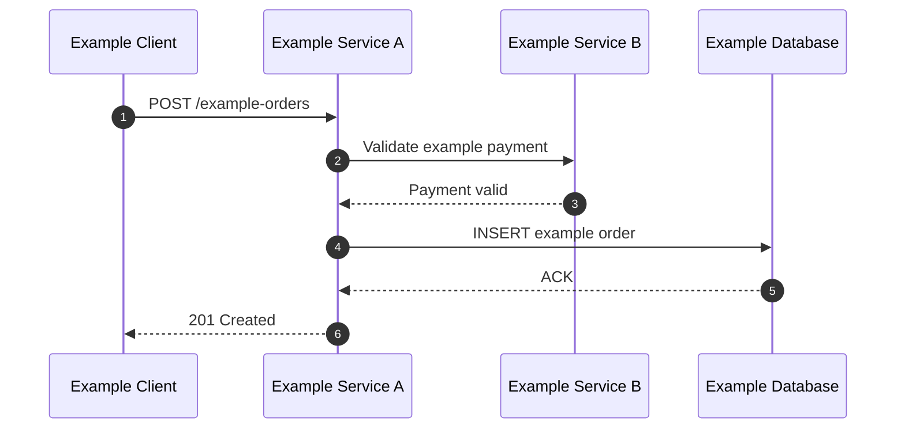
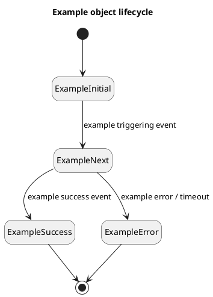
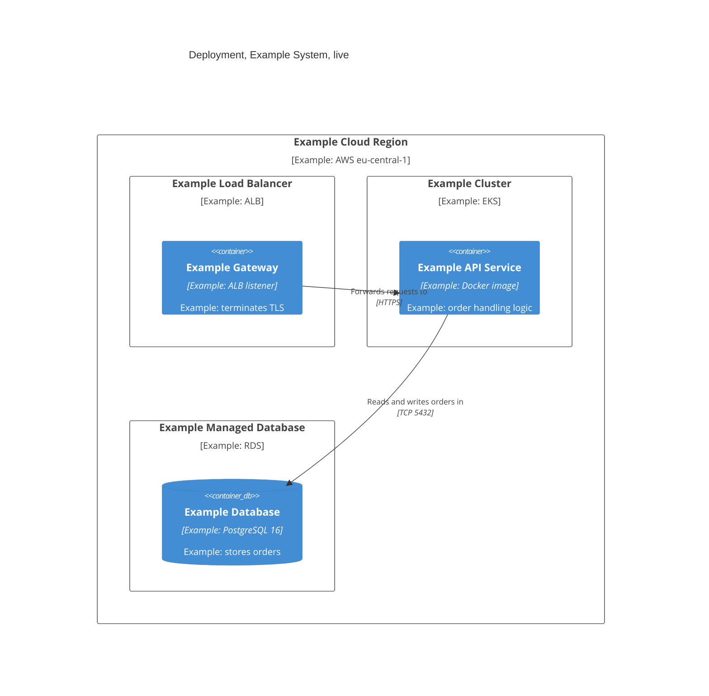
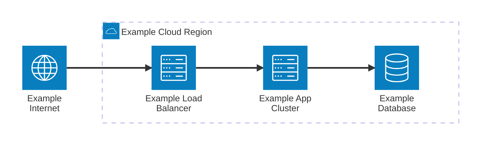
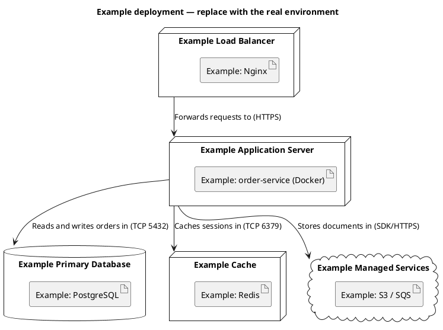
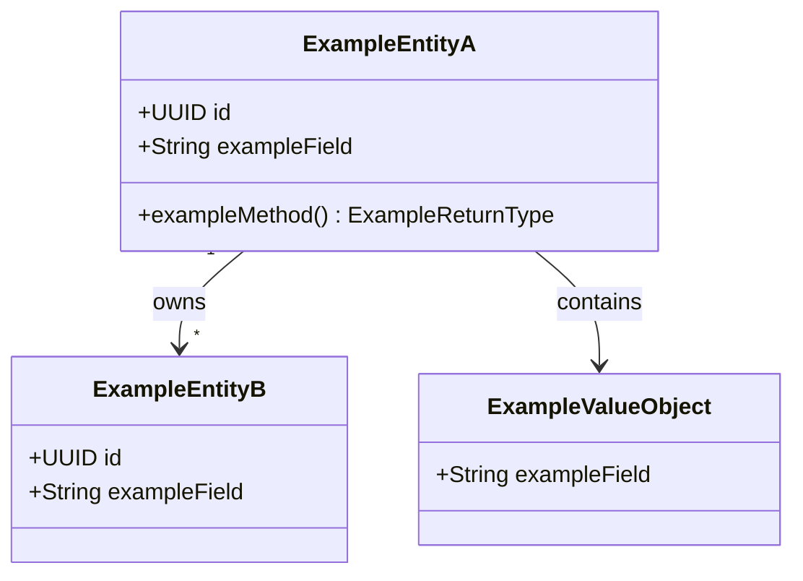
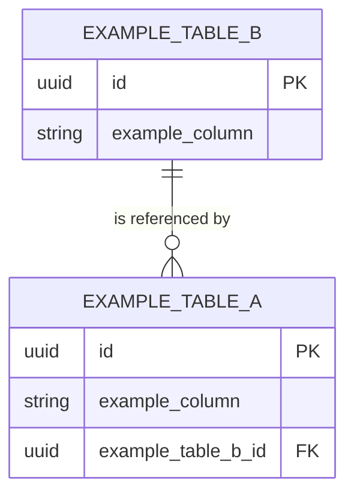

# Diagrams — Reference

Load this file when: generating a diagram, choosing between Mermaid and PlantUML, selecting a diagram type for an arc42 section, or scaffolding a visual from scratch.

See also:

- [c4-model.md](./c4-model.md) — C4 theory, 4 levels, supplementary diagrams, tooling, notation checklist, embed vs. link rules
- [uml-types.md](./uml-types.md) — full UML 2.x taxonomy, arc42 section → type matrix
- [mermaid-reference.md](./mermaid-reference.md) — complete Mermaid syntax for all architecture diagram types
- [plantuml-reference.md](./plantuml-reference.md) — PlantUML syntax for deployment, state, activity, component
- [diagram.md](../../operations/architecture/diagram.md) — step-by-step diagram generation process

---

## C4 model → arc42 section mapping

The C4 model (Context → Container → Component → Code) maps directly onto arc42's structural sections:

| C4 Level            | arc42 Section                            | Audience               |
| ------------------- | ---------------------------------------- | ---------------------- |
| Level 1 — Context   | 3 (Context and Scope)                    | All stakeholders       |
| Level 2 — Container | 5 (Building Block View, Level 1)         | Tech leads, architects |
| Level 3 — Component | 5 (Building Block View, Level 2+)        | Developers             |
| Level 4 — Code      | Rarely maintained — skip unless critical | Implementers only      |
| System Landscape    | 3 (multi-system estates only)            | All stakeholders       |
| Dynamic             | 6 (Runtime View)                         | Developers, architects |
| Deployment          | 7 (Deployment View)                      | Ops, architects        |

**Rule**: Always create Level 1 (sec 3) and Level 2 (sec 5). Level 3 only for complex or security-sensitive containers. Level 4: auto-generate from code or skip entirely.

---

## Diagram selection by arc42 section

| arc42 Section                         | Primary diagram                         | Secondary                                 | Tool                                                      |
| ------------------------------------- | --------------------------------------- | ----------------------------------------- | --------------------------------------------------------- |
| 3 — Context and Scope                 | C4 Context                              | C4 System Landscape, DFD Level 0          | Mermaid `C4Context`                                       |
| 5 — Building Block View               | C4 Container (L1) + C4 Component (L2+)  | UML Component                             | Mermaid `C4Container` / `C4Component`                     |
| 6 — Runtime View                      | Sequence diagram                        | C4 Dynamic, state machine (per lifecycle) | Mermaid `sequenceDiagram` / `C4Dynamic` or PlantUML       |
| 7 — Deployment View                   | C4 Deployment / infrastructure topology | Cloud architecture diagram                | Mermaid `C4Deployment` / `architecture-beta`, or PlantUML |
| 8 — Cross-cutting (domain model)      | Class diagram or ER diagram             | —                                         | Mermaid `classDiagram` or PlantUML                        |
| 9 — Architecture Decisions (optional) | Decision flowchart                      | —                                         | Mermaid `flowchart`                                       |

---

## Tool selection: Mermaid vs PlantUML

| Criterion              | Mermaid                                                                                | PlantUML                                                                  |
| ---------------------- | -------------------------------------------------------------------------------------- | ------------------------------------------------------------------------- |
| Native rendering       | GitHub, GitLab. Confluence needs a Marketplace app; VS Code preview needs an extension | Requires server or plugin                                                 |
| Best for               | C4, flowcharts, sequence, class, ER                                                    | Deployment topology, state machines, activity                             |
| C4 diagrams            | Experimental: all five C4 types, but no legend, tags, `Lay_*` layout or sprites        | C4-PlantUML: legend (`SHOW_LEGEND()`), tags, layout control; more verbose |
| Deployment diagrams    | `C4Deployment` (nested nodes) and `architecture-beta` (groups, services, icons)        | Full node/artifact/cloud/database notation                                |
| State machines         | Limited (`stateDiagram-v2`)                                                            | Full support with guards and history states                               |
| Activity with parallel | Flowchart approximation only                                                           | Full fork/join notation                                                   |

**Default rule**: Use Mermaid unless the diagram needs PlantUML's richer notation — specifically: UML deployment notation (artifacts, stereotypes) beyond what `C4Deployment`/`architecture-beta` give, a rendered C4 legend or layout control (C4-PlantUML), state machines with guards, and activity diagrams with parallel forks.

---

## State machine vs activity diagram (arc42 sec 6)

**State machine** — models an object's lifecycle: states + event-driven transitions.

- Use when behavior depends on the object's current state.
- Examples: order lifecycle (Pending → Processing → Shipped), ticket status.
- Tool: PlantUML state diagram (`[*] -->` notation).

**Activity diagram** — models a workflow or process: steps + decisions + parallel branches.

- Use when showing a process that flows automatically from step to step.
- Examples: user registration flow, payment processing pipeline.
- Tool: PlantUML activity diagram (`start / if / fork / stop`) or Mermaid `flowchart`.

**Key distinction**: state machines wait for events; activity diagrams flow automatically.

---

## Scaffolds

Paste the matching scaffold into the concept file's fenced code block. Every scaffold renders as-is: fillable slots are obviously fake example values (`Example…`, `example-…`, `EXAMPLE_…`) and hints are diagram comments (`%%` in Mermaid, `'` in PlantUML). Replace every example value and delete the hint comments — do not commit unfilled scaffolds. Never put HTML comments (`<!-- -->`) inside a diagram block: they are not Mermaid or PlantUML syntax and break rendering.

Relationship labels are specific verbs that read in the arrow's direction ("Places orders using"), never a bare "Uses". Mermaid C4 cannot render a legend — add a short key below the diagram (see [c4-model.md](./c4-model.md) → Notation checklist).

### Section 3 — Context and Scope (Mermaid C4Context)

````markdown

````

For a **System Landscape** view, use the same `C4Context` syntax with several `System(...)` elements inside `Enterprise_Boundary(alias, "Example Org") { ... }` and no single system in focus.

---

### Section 5 — Building Block View (Mermaid C4Container)

````markdown

````

For a Level 3 component view inside one container, replace `C4Container` with `C4Component`, `System_Boundary(...)` with `Container_Boundary(...)` (the container being decomposed), and the inner `Container(...)` elements with `Component(...)`. Keep neighbouring containers and external systems outside the boundary.

---

### Section 6 — Runtime View (Mermaid sequence)

````markdown

````

When the collaborating structure matters more than message order, use a C4 **Dynamic** diagram: `C4Dynamic` with the same elements as `C4Container`/`C4Component` and `Rel(...)` statements written in execution order (Mermaid numbers them by statement order).

For **object lifecycle** scenarios use a PlantUML state machine instead:

````markdown

````

---

### Section 7 — Deployment View (Mermaid C4Deployment)

````markdown

````

### Section 7 — Deployment View (Mermaid architecture-beta)

For an infrastructure view with icons, `architecture-beta` (Mermaid 11.1+) draws groups, services and edges between `T`/`B`/`L`/`R` ports. Built-in icons: `cloud`, `database`, `disk`, `internet`, `server`; registered iconify packs add vendor icons. Its edges carry no documented labels, so name protocols and ports in the building-block mapping table instead. Syntax: https://mermaid.js.org/syntax/architecture.html.

````markdown

````

When you need full UML deployment notation (artifacts, stereotypes), use PlantUML:

````markdown

````

---

### Section 8 — Cross-cutting: domain model (Mermaid class diagram)

````markdown

````

For a **database schema** view, use a Mermaid ER diagram instead:

````markdown

````
