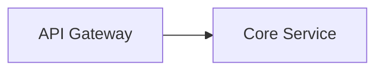

# Building Block View — Level 1

<!-- Static structure: the overall system as a whitebox of black-box building blocks.
     Add Level 2 / Level 3 whiteboxes only for subsystems that need them, as separate files.
     The context diagram belongs to §3, not here. -->

## Level 1 — Whitebox overall system

<!-- Diagram here (Mermaid, PlantUML, or link to image asset). -->

### Contained building blocks

| Building block        | Responsibility                            |
| --------------------- | ----------------------------------------- |
| <!-- API Gateway -->  | <!-- route and auth external requests --> |
| <!-- Auth Service --> | <!-- issue and validate JWT tokens -->    |
| <!-- Core Service --> | <!-- business logic -->                   |
| <!-- Data Store -->   | <!-- persistence layer -->                |

### Important interfaces

<!-- The external interfaces from §3, with the same IF-xx IDs: arc42-lint RULE-1 requires the two sets
     to match exactly. Interfaces between internal building blocks belong in the Level 2 whiteboxes. -->

| ID    | Interface             | Between                             | Protocol            |
| ----- | --------------------- | ----------------------------------- | ------------------- |
| IF-01 | <!-- Auth service --> | <!-- API Gateway ↔ Auth service --> | <!-- REST/HTTPS --> |
| IF-02 | <!-- Message bus -->  | <!-- Message bus → Core Service --> | <!-- AMQP -->       |

## Level 2 — <!-- Key subsystem name -->

<!-- Repeat the whitebox pattern for each subsystem worth detailing (Level 2), and for
     its parts only where needed (Level 3). One file each, e.g. building-block-auth-service.md -->
