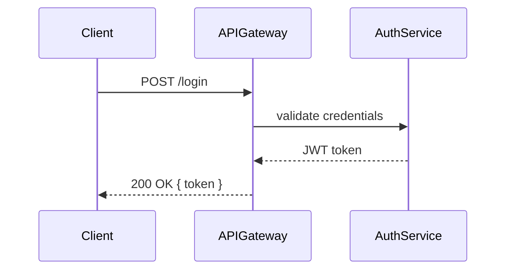

# Runtime View — <!-- Scenario name -->

<!-- One runtime scenario per file. Focus on non-obvious interactions:
     startup, auth flows, error paths, high-load behaviours.
     For simple CRUD, only document what would surprise a new team member. -->

## Scenario: <!-- e.g. User authentication flow -->

**Trigger:** <!-- what initiates this scenario -->

**Actors involved:** <!-- which building blocks participate -->

### Sequence

### Notes

- <!-- What is non-obvious about this flow? -->
- <!-- What error paths exist? Where do failures surface? -->
- <!-- What are the performance characteristics? -->
