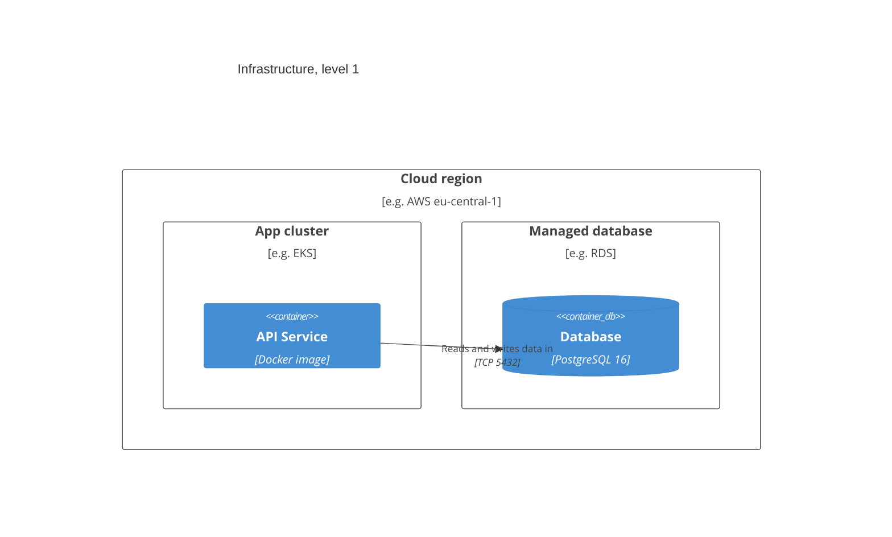
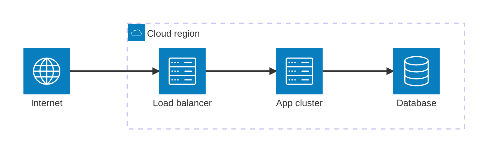

# Deployment View

<!-- Infrastructure and how the software maps onto it (arc42 v9: Infrastructure Level 1, Level 2).
     Every §5 Level 1 building block must appear in the mapping (arc42-lint RULE-2).
     Deployment procedures (step-by-step runbooks) are separate how-to files. -->

## Infrastructure Level 1

<!-- Pick one view and delete the other. Text views (C4Deployment, architecture-beta) diff cleanly in review;
     for a stakeholder-facing overview with cloud icons, use draw.io instead (references/drawio.md)
     and embed the .drawio.svg file as an image with real alt text. -->

Option A — C4 deployment view:

Option B — infrastructure view with icons:

**Motivation:** <!-- why this infrastructure: constraints from §2, quality goals from §1.2 -->

**Quality and performance features:** <!-- e.g. multi-AZ, autoscaling limits, RPO/RTO -->

### Mapping of building blocks to infrastructure

| Building block         | Runs on                  | Scaling                   |
| ---------------------- | ------------------------ | ------------------------- |
| <!-- API Service -->   | <!-- ECS Fargate -->     | <!-- 2–10 replicas -->    |
| <!-- DB -->            | <!-- RDS PostgreSQL -->  | <!-- Multi-AZ standby --> |
| <!-- Static assets --> | <!-- S3 + CloudFront --> | <!-- CDN -->              |

### Environments

| Environment | Purpose             | URL / Access |
| ----------- | ------------------- | ------------ |
| dev         | local development   | localhost    |
| staging     | integration testing | <!-- url --> |
| production  | live system         | <!-- url --> |

## Infrastructure Level 2

<!-- Internals of selected infrastructure elements (e.g. the app cluster's node pools, the
     network zones). Add only where Level 1 is not enough. -->

## Deployment runbooks

Step-by-step procedures:

- [How to deploy to production](./how-to-deploy-production.md)
- <!-- [How to roll back a release](./how-to-rollback.md) — link each runbook once it exists -->

## Runbook risk matrix

Every runbook linked above must declare its risk level. Use this table to determine required approvals and rollback policy:

| Risk level | Criteria                                      | Approval required  | Must test in staging  | Rollback plan |
| ---------- | --------------------------------------------- | ------------------ | --------------------- | ------------- |
| Low        | No production data affected; fully reversible | Self-service       | Recommended           | Optional      |
| Medium     | Affects non-critical production paths         | Team lead sign-off | Required              | Recommended   |
| High       | Affects live data or primary user-facing path | Architect sign-off | Full staging run      | Required      |
| Critical   | Full-system impact or irreversible change     | Lead + stakeholder | Prod-like environment | Mandatory     |
