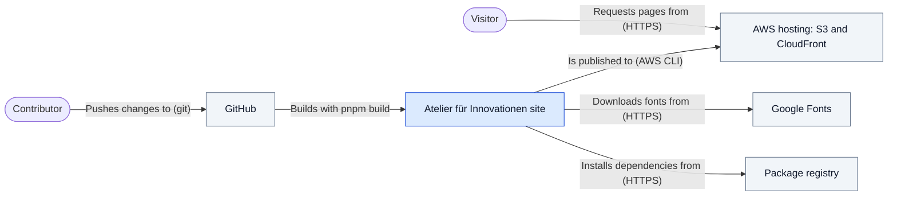

# Context and Scope

The system is a static documentation website. At run time it is a folder of files served by a CDN. Everything that makes it dynamic (search, theming, navigation) runs in the visitor's browser. The context therefore has two halves: the visitors who read it, and the build and hosting chain that produces and serves the files.

## Business context

_Figure: system context (C4 level 1 content, drawn as a flowchart because Mermaid's C4 layout crosses its arrows). Key: rounded boxes are people, the blue box is the system in scope, grey boxes are external systems. The visitor talks to the CDN, never to the build._

| External entity  | Communication                                              | Direction |
| ---------------- | ---------------------------------------------------------- | --------- |
| Visitor          | Reads pages, searches, views slides and illustrations      | → CDN     |
| Contributor      | Adds or edits content and code; merging to `main` deploys  | → System  |
| GitHub           | Stores the source, runs the workflow on every push to main | ↔ System |
| AWS hosting      | Receives the static export, serves it to visitors          | ← System  |
| Google Fonts     | Provides font files during the build                       | → System  |
| Package registry | Provides dependencies during install                       | → System  |

## Technical context

Every interface has a stable `IF-xx` ID. The protocols, formats and directions are in the [interface table](./interface-table.md); [§5](../05-building-blocks/building-blocks-level1.md) uses the same IDs.

## System boundary notes

Inside the boundary: the Next.js application, the MDX content, the image optimization step, the validation script and the deploy workflow.

Outside the boundary:

- **Hosting infrastructure.** The S3 bucket, the CloudFront distribution and the domain are configured outside this repository. Only their identifiers reach the workflow, as repository secrets and variables.
- **Agent tooling.** `.sandcastle/` and `scripts/run-sandcastle.ts` run unattended coding agents against GitHub issues. They change the repository but never ship in the site. They are described in [About the epic/afk workflow](../../explanation/about-the-epic-afk-workflow.md).
- **Published product content.** What `src/content/docs/` says about Xenia and the Wissensstadt belongs to the domain glossary ([`docs/reference/glossary.md`](../../reference/glossary.md)), not to this architecture.
- **Visitor tracking.** A search of `src/` and `next.config.mjs` finds no analytics, cookies or third-party scripts. The site makes no calls to other systems at run time.
