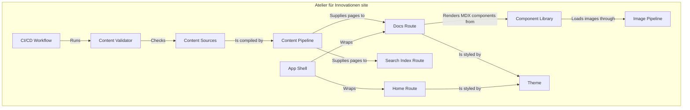

# Building Block View — Level 1

The site is a build pipeline that turns MDX files into static files. Eleven building blocks cover everything in the repository that ships or gates a change. The context diagram is in [§3](../03-context/context-and-scope.md).

## Level 1 — Whitebox overall system

_Figure: building blocks (C4 level 2 content, drawn as a flowchart). Arrows read in the label's direction. The external parties and their IF-xx interfaces are in [§3](../03-context/interface-table.md) and the table below._

### Contained building blocks

| Building block     | Responsibility                                                                                                                    | Source location                                                     | Communication                                              |
| ------------------ | --------------------------------------------------------------------------------------------------------------------------------- | ------------------------------------------------------------------- | ---------------------------------------------------------- |
| Content Sources    | Hold the published pages (`atelier/`, `xeniapolis/`, root pages) and each folder's `meta.json` with section title, icon and order | `src/content/docs/`                                                 | Read by the Content Pipeline at install/build              |
| Content Pipeline   | Compile MDX, generate `.source/`, expose the page tree and page lookup with base URL `/docs`                                      | `source.config.ts`, `src/lib/source.ts`, generated `.source/`       | In-process imports at build time                           |
| Docs Route         | Render one static page per slug and the docs layout, derive the section for `data-section`                                        | `src/app/docs/[[...slug]]/`                                         | In-process; output is HTML                                 |
| Home Route         | Render the landing page and its hero and footer                                                                                   | `src/app/(home)/`, `src/app/_components/`                           | In-process; output is HTML                                 |
| Search Index Route | Emit the static search index from the page tree                                                                                   | `src/app/api/search/route.ts`                                       | Output is JSON, fetched by the browser                     |
| App Shell          | Mount the root provider, fonts and static search config, define the shared navigation                                             | `src/app/layout.tsx`, `src/app/layout.config.tsx`                   | In-process React providers                                 |
| Component Library  | Provide MDX components not in Fumadocs: slides, illustrations, image zoom, overview cards, tabs wrapper, button variants          | `src/components/`, `src/data/`                                      | Imported explicitly by MDX pages                           |
| Theme              | Provide the default and Xeniapolis palettes, design tokens and font variables                                                     | `src/lib/styles/` (`globals.css`, `theme.css`, `fonts/`)            | CSS custom properties                                      |
| Image Pipeline     | Resize every image in `public/` to WebP, generate blur placeholders, copy results into `out/_optimized/`                          | `public/`, `next.config.mjs` (`env`), `next-image-export-optimizer` | Runs after `next build`                                    |
| Content Validator  | Fail when a Markdown or MDX file has no `type` frontmatter                                                                        | `scripts/validate-okf.ts`, `scripts/validate-okf.test.ts`           | Command line, `pnpm validate:okf`                          |
| CI/CD Workflow     | Check format, lint and types; run tests and the Content Validator; then build, sync to S3, invalidate CloudFront                  | `.github/workflows/main.yml`                                        | GitHub Actions jobs `quality`, `validate-okf` and `deploy` |

### Important interfaces

The external interfaces from [§3](../03-context/interface-table.md), with the same IDs.

| ID    | Interface        | Between                                                               | Protocol                         |
| ----- | ---------------- | --------------------------------------------------------------------- | -------------------------------- |
| IF-01 | Visitor          | Static export (Docs Route, Home Route, Search Index Route) ↔ Visitor | HTTPS                            |
| IF-02 | GitHub           | Content Sources, source code ↔ GitHub repository                     | git                              |
| IF-03 | AWS hosting (S3) | CI/CD Workflow → S3 bucket                                            | S3 API over HTTPS, `aws s3 sync` |
| IF-04 | AWS hosting (CF) | CI/CD Workflow → CloudFront distribution                              | AWS API over HTTPS               |
| IF-05 | Google Fonts     | Theme ← Google Fonts                                                  | HTTPS, build time                |
| IF-06 | Package registry | CI/CD Workflow, local install ← Package registry                      | HTTPS                            |

### Dependencies

- Content Pipeline feeds both Docs Route and Search Index Route from one page tree, so the sidebar and the search index cannot disagree.
- The dependency direction is one-way: Content Sources → Content Pipeline → routes → static files. No route writes back to the content.
- `Component Library` pages import `src/data/*.json` at build time. There is no run-time data source.
- No circular dependency found.

## Level 2

No Level-2 whitebox yet. Docs Route (section derivation, tab icon transform) is the one block with non-obvious internal structure; see [Per-section theming](../08-crosscutting/section-theming-strategy.md) before adding one.
