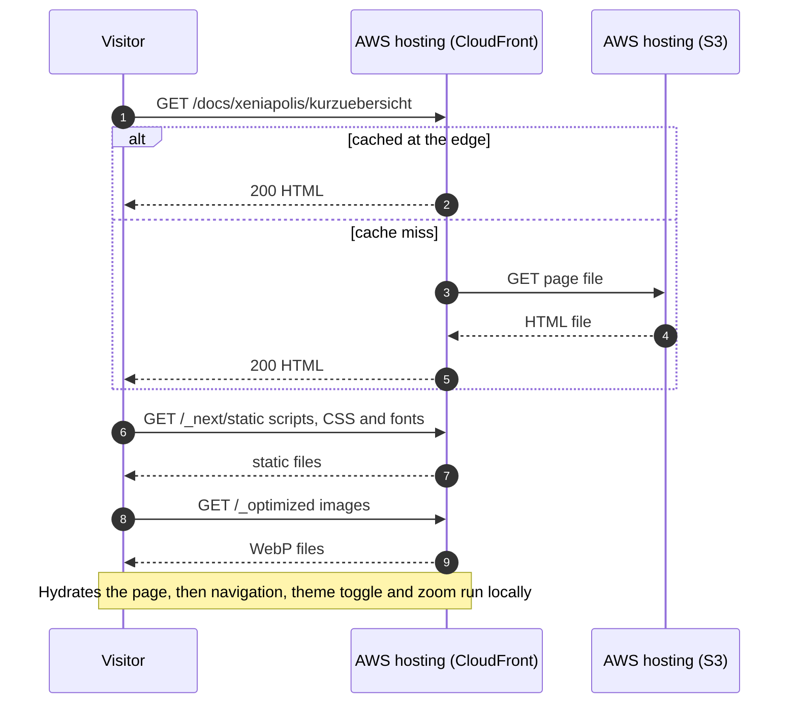

# Runtime View — Page view

The site is a static website on S3, served by CloudFront. No application code runs at request time. Everything a page needs was produced by `pnpm build`, so a page view is a sequence of file downloads followed by work in the browser.

## Scenario: Visitor opens a docs page

**Trigger:** a visitor opens a URL such as `/docs/xeniapolis/kurzuebersicht`.

**Actors involved:** Visitor, AWS hosting (CloudFront), AWS hosting (S3). Building blocks: the static output of Docs Route, App Shell, Theme and Image Pipeline.

### Sequence

_Figure: page view, sequence. Participant names match [§3](../03-context/context-and-scope.md)._

### Notes

- **Section theme is already in the HTML.** The Docs Route wraps Xeniapolis pages in `data-section="xeniapolis"` while building, so the right palette applies on first paint. The browser does not decide it.
- **Same origin throughout.** Fonts come from `/_next/static`, not from Google (see IF-05 in the [interface table](../03-context/interface-table.md)). A page view contacts no system other than CloudFront.
- **Freshness.** A page stays cached until its entry expires or the next deploy invalidates `/*`. Cache lifetimes are not set in this repository.
- **URL to file mapping.** `trailingSlash: true` makes the export write `out/docs/index.html` and `out/docs/atelier/index.html`. The CloudFront Function `RewriteSPAUrls` (viewer request, defined in the AWS account, not in this repository) appends `/index.html` to a path with no file extension and `index.html` to a path ending in `/`, except under `/api/search`. A request for `/docs/atelier` therefore resolves to the S3 key `docs/atelier/index.html`. With the earlier layout (`docs/atelier.html`) that key did not exist and S3 answered 403. `scripts/check-deployed.ts` requests every sitemap address after each deploy.
- **Unknown URL.** The export includes `404.html`. Whether CloudFront returns it with status 404 depends on the distribution's error-page setting, which the repository does not show.

## See also

- [Search](./runtime-search.md)
- [Publishing a change](./runtime-publish-change.md)
- [Static Export Strategy](../08-crosscutting/static-export-strategy.md)
