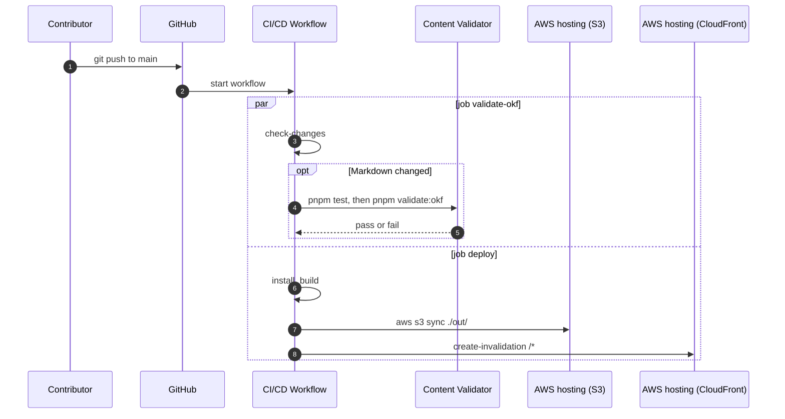

# Runtime View — Publishing a change

## Scenario: Contributor pushes to `main`

**Trigger:** a push to `main` on GitHub.

**Actors involved:** Contributor, GitHub, CI/CD Workflow, Content Validator, AWS hosting (S3), AWS hosting (CloudFront).

### Sequence

_Figure: publishing a change, sequence. The jobs run in parallel because `deploy` has no `needs:`._

### Failure handling

| Failure                             | Effect                                                                                                                     |
| ----------------------------------- | -------------------------------------------------------------------------------------------------------------------------- |
| `validate-okf` fails                | The run is marked failed. `deploy` is not affected and still publishes. See [RISK-03](../11-risks/risks-and-tech-debt.md). |
| `pnpm build` fails                  | `deploy` stops before the sync. The live site keeps the previous version.                                                  |
| `aws s3 sync` fails part-way        | [INFERENCE] The bucket holds a mix of old and new files until the next successful run.                                     |
| Invalidation fails                  | New files are in S3. Visitors may still get cached pages until their cache entries expire.                                 |
| A page was removed from the content | Its file stays in S3 because the sync has no `--delete`. See [RISK-04](../11-risks/risks-and-tech-debt.md).                |

### Notes

- Nothing publishes except the push to `main`. There is no preview build and no manual approval step.
- [INFERENCE] A broken MDX file fails `pnpm build` and so never reaches S3. No test in the repository exercises this.
- Credentials: `deploy` authenticates with the secrets listed in [Security conventions](../08-crosscutting/security-conventions.md).

## See also

- [How to build and deploy the site](../../how-to/how-to-build-and-deploy.md)
