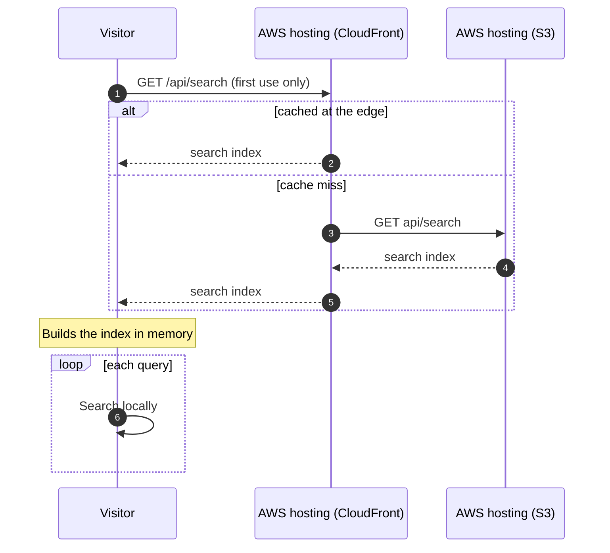

# Runtime View — Search

## Scenario: Visitor searches the docs

**Trigger:** a visitor opens the search dialog and types a query.

**Actors involved:** Visitor, AWS hosting (CloudFront), AWS hosting (S3). Building blocks: the Search Index Route output and the App Shell, which configures the search provider with `type: 'static'`.

### Sequence

_Figure: search, sequence._

### Notes

- The index is one file, `out/api/search`, written at build time by the Search Index Route from the same page tree as the sidebar. In the local `out/` checked on 2026-11-05 it is about 2.3 MB. See [RISK-05](../11-risks/risks-and-tech-debt.md).
- After the download, queries cost no further requests.
- **Failure mode.** If the route exports the dynamic `GET` instead of `staticGET`, `next build` still succeeds and search breaks after deploy, because no server exists to answer `/api/search`. [Static search API route](../../reference/fumadocs/search-route.md) documents the rule. Nothing in CI catches it.
- A new page appears in search only after the next deploy and cache invalidation.

## See also

- [Page view](./runtime-main-flow.md)
