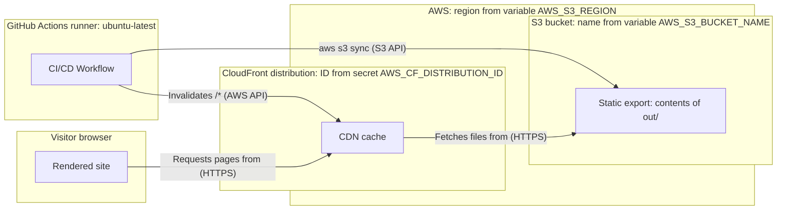

# Deployment View

The site has one deployed environment. A push to `main` builds the static export on a GitHub-hosted runner, copies it to an S3 bucket and invalidates the CloudFront cache. No application server runs anywhere.

## Infrastructure Level 1

_Figure: deployment, production (C4 deployment content, drawn as a flowchart). Boxes with a title are infrastructure nodes. The site is a static website on S3 served by CloudFront (confirmed by the maintainer); the repository has no infrastructure code that shows how the two are wired._

**Motivation:** a static export needs no application runtime to run, patch or scale (see [Static export strategy](../08-crosscutting/static-export-strategy.md)).

**Quality and performance features:** [INFERENCE] CloudFront caches at its edge locations. The workflow invalidates `/*` on every deploy, so a deploy never leaves a stale page behind once the invalidation completes. Scaling, availability targets and cache TTLs are not configured in this repository. The rewrite of extensionless URLs to `index.html` is a CloudFront Function in the AWS account; the export layout (`trailingSlash: true`) is what it relies on ([page view](../06-runtime/runtime-main-flow.md)).

### Mapping of building blocks to infrastructure

| Building block     | Runs on                                                                  | Scaling                                 |
| ------------------ | ------------------------------------------------------------------------ | --------------------------------------- |
| Content Sources    | Git repository on GitHub; files in `out/` after build                    | None                                    |
| Content Pipeline   | GitHub Actions runner during `pnpm build`                                | None, one job per push                  |
| Docs Route         | Build time on the runner; HTML in S3                                     | CDN, no application code at run time    |
| Home Route         | Build time on the runner; HTML in S3                                     | CDN                                     |
| Search Index Route | Build time on the runner; JSON in S3, searched in the visitor's browser  | CDN, search cost is paid by the browser |
| App Shell          | Build time on the runner; hydrates in the visitor's browser              | None                                    |
| Component Library  | Build time on the runner; client components run in the visitor's browser | None                                    |
| Theme              | CSS file in S3, applied in the visitor's browser                         | CDN                                     |
| Image Pipeline     | GitHub Actions runner, after `next build`; WebP files in S3              | None                                    |
| Content Validator  | GitHub Actions runner, job `validate-okf`; also local                    | None                                    |
| CI/CD Workflow     | GitHub Actions runner `ubuntu-latest`                                    | Managed by GitHub                       |

### Environments

| Environment | Purpose                                         | URL / Access                                                        |
| ----------- | ----------------------------------------------- | ------------------------------------------------------------------- |
| local       | Authoring and preview: `pnpm dev`, `pnpm start` | `http://localhost:3000`                                             |
| production  | Live site, deployed on every push to `main`     | https://atelier-fuer-innovationen.mrpitch.rocks (`src/lib/site.ts`) |

There is no staging environment and no preview deployment. A merge to `main` is a production release.

## Deployment procedures

- [How to build and deploy the site](../../how-to/how-to-build-and-deploy.md): local build, what CI does, required secrets and variables, manual deploy as a fallback.
