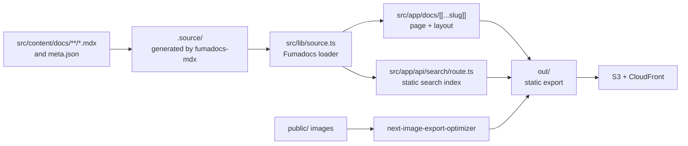

# About the architecture

The site is a content site, not an application. Authors write MDX, and a build turns it into static files that sit in an S3 bucket behind CloudFront. Everything else in the codebase serves that path.

## The pieces

- **Content** lives in `src/content/docs/`. Two top-level folders, `atelier/` and `xeniapolis/`, are the two sections. Each folder's `meta.json` marks it as a sidebar tab and orders its pages.
- **`fumadocs-mdx`** reads that folder at install and build time (configured in `source.config.ts`) and generates `.source/`. Nothing in `.source/` is edited by hand.
- **The loader** in `src/lib/source.ts` turns the generated collection into a page tree with the base URL `/docs`. Layouts and routes ask it for pages.
- **The docs route**, `src/app/docs/[[...slug]]/`, renders one page for every slug the loader reports through `generateStaticParams`. This is what makes every page a static file.
- **The home page** is a separate route group, `src/app/(home)/`, with its own layout.
- **Search** is a static index. The route in `src/app/api/search/route.ts` exports `staticGET`, and the root layout configures the search provider with `type: 'static'`, so the browser downloads the index and searches it locally. There is no search server.
- **Images** go through `next-image-export-optimizer`, which resizes everything in `public/` after `next build` finishes.

## Why a static export

`output: 'export'` in `next.config.mjs` means the build produces HTML, JSON and assets and nothing else. The deploy is then `aws s3 sync` plus a CloudFront invalidation, with no server to run, patch or scale. The cost is that nothing can run per request: no server-side API routes, no request-time rendering. That is why search is a prebuilt index and why the custom image loader exists, since the default Next.js image optimizer needs a server.

## Two sections, one codebase

Atelier and Xeniapolis share the layout, components and routes. They differ in palette. The docs layout puts `data-section="xeniapolis"` on a wrapper when the current page belongs to the Xeniapolis section, and CSS custom properties switch the whole page. The reasoning is in [About section theming](./about-section-theming.md), and the exact scoping rules are in [Per-section theming](../reference/fumadocs/section-theming.md).

## The component layer

Fumadocs supplies the layout, the page chrome and most MDX components, from `@fumadocs/base-ui`. The repo's own `src/components/` adds what Fumadocs does not provide: zoomable images, slides, illustrations, overview cards, and a tabs wrapper. The docs route registers only the Fumadocs defaults, so a page imports anything else explicitly. See [Components](../reference/components.md).

## Related decisions

- [ADR 0001](../architecture/09-decisions/adr-0001-adopt-fumadocs-base-ui.md): `@fumadocs/base-ui` instead of `fumadocs-ui`.
- [ADR 0002](../architecture/09-decisions/adr-0002-per-section-theming.md): per-section theming through CSS custom-property scoping.
